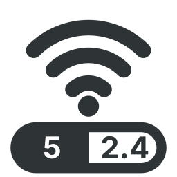
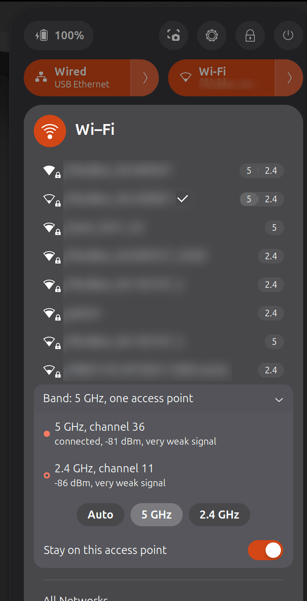

<p align="center"></p>

# Wi-Fi Bands

Voyez sur quelles bandes se trouve chaque réseau Wi-Fi, et choisissez la bande
de celui auquel vous êtes connecté, directement dans le menu Wi-Fi des réglages
rapides de GNOME.

<p align="center"></p>

## Pourquoi

GNOME affiche une ligne par réseau et ne dit rien de la radio qui se cache
derrière. La plupart des box émettent le même nom en 2,4 GHz et en 5 GHz, et
beaucoup font deux choses invisibles depuis l'ordinateur :

- **Le band steering.** La box pousse l'ordinateur vers le 2,4 GHz quand le
  signal 5 GHz est faible, puis le ramène en 5 GHz quelques secondes plus tard, et
  ainsi de suite. Chaque déplacement coupe la connexion un instant et
  l'ordinateur perd son adresse. De la chaise, cela donne un Wi-Fi qui « se fige
  quelques secondes toutes les quelques minutes ».
- **Les canaux radar.** Les canaux 5 GHz 52 à 64 et 100 à 144 doivent céder la
  place aux radars météo et militaires. Une box réglée sur « automatique » y
  atterrit souvent, et à chaque détection de radar elle change de canal et tout
  le monde est déconnecté en même temps.

Rien dans le bureau ne le dit, et la seule façon d'agir était le terminal
(`nmcli con modify … 802-11-wireless.band a`). Cette extension met ce qui se
passe, et le choix, là où vous cherchez déjà le Wi-Fi.

Sur la machine pour laquelle elle a été faite, fixer la bande 5 GHz et un seul
point d'accès a fait passer les déplacements entre radios d'un toutes les deux à
vingt-cinq minutes à aucun sur les heures suivantes, et la latence vers la box
est devenue environ quatre fois plus régulière.

## Ce que vous obtenez

- **Une pilule sur chaque réseau** : `5 | 2,4` s'il est sur les deux bandes, `5`
  ou `2,4` s'il n'est que sur une. La bande utilisée est le segment le plus
  clair. Couleurs neutres, comme le reste des réglages rapides, et la coche reste
  à côté du nom.
- **Une entrée Bande** sous la liste, pour le réseau auquel vous êtes connecté.
  Ouverte, elle montre chaque point d'accès (bande, canal, signal) avec une
  pastille de santé et la raison :
  - vert : bon ;
  - jaune : signal faible, canal encombré, canal sensible aux radars, ou
    l'ordinateur change souvent de point d'accès ;
  - rouge : signal très faible, ou ce point d'accès a déjà refusé la connexion.
- **Auto, 5 GHz ou 2,4 GHz**, et un interrupteur pour **rester sur un seul point
  d'accès**. Seul le profil du réseau en cours est modifié.
- **Un filet de sécurité.** Si la box ne laisse pas se connecter dans les 25
  secondes qui suivent un changement, le réglage précédent revient tout seul et ce
  point d'accès est marqué comme ayant refusé. Un changement encore en cours de
  vérification quand l'extension a été désactivée (écran verrouillé, par
  exemple) est vérifié au démarrage suivant.

## Avantages

- Choisir une bande prend deux clics, sans terminal.
- On voit d'un coup d'œil quels réseaux ont une radio 5 GHz, avant de se
  connecter.
- Un mauvais choix ne peut pas vous laisser sans Wi-Fi : il est repris.
- Rien à installer en dehors de l'extension, pas de root, pas de programme
  d'accompagnement. Elle ne lance aucune commande : elle parle à NetworkManager
  par sa propre bibliothèque (libnm).
- Rien n'est ajouté à la barre du haut, et rien n'est envoyé nulle part.
- Elle marche avec n'importe quelle box, puisqu'elle ne modifie que votre propre
  profil de connexion.

## Comment les couleurs sont décidées

Elles ne sont pas négociées avec la box : l'extension les calcule d'après ce que
NetworkManager rapporte. Son échelle de signal (0 à 100) est le signal en dBm
plus 120. Bon : -67 dBm ou mieux ; mauvais : sous -80 dBm. Un canal où se trouvent
au moins deux autres réseaux à une force utilisable est « encombré ». Une
pastille pleine est mesurée sur le point d'accès utilisé ou déjà essayé ; une
pastille vide n'est qu'une estimation faite au scan.

## Limites

- Elle ne peut pas couper le band steering de la box, que les autres appareils
  subissent toujours. Si votre box le permet, c'est la solution la plus propre ;
  sur une box d'opérateur verrouillée, il faudra peut-être le demander à
  l'opérateur.
- La santé est une estimation d'après la force du signal et le scan. La vraie
  qualité (retransmissions, latence) n'est pas visible depuis une extension du
  Shell.
- Seules les bandes 2,4 et 5 GHz sont gérées, pas le 6 GHz.
- Une bande n'est proposée que si le réseau y est vu depuis l'endroit où vous
  êtes.
- Avec plusieurs cartes Wi-Fi, les pilules ne sont pas affichées, et l'entrée
  Bande suit la carte en cours.

## Installation

```
gnome-extensions install --force wifi-bands@griffit.gmail.com.shell-extension.zip
gnome-extensions enable wifi-bands@griffit.gmail.com
```

Fermez et rouvrez la session si l'extension n'apparaît pas tout de suite
(Wayland). Le zip se construit avec `./pack.sh`. Fonctionne avec GNOME Shell 45
à 51.

## Tests

```
tests/run.sh                          # les règles, sans le Shell
tools/headless/run.sh                 # un vrai GNOME Shell sans écran, en lecture seule
ACTIONS=1 tools/headless/run.sh       # change aussi la bande, avec un refus
```

Le banc d'essai utilise le vrai NetworkManager : avec `ACTIONS=1`, le Wi-Fi se
reconnecte plusieurs fois, et le profil est remis à la fin.

## Feuille de route et tickets

Défauts, idées, travail prévu et essais encore à faire sont suivis dans les
[tickets GitHub](https://github.com/d101c/wifi-bands/issues) ; ce qui est
prévu pour la prochaine version est regroupé dans un jalon (milestone).

- **Signaler un défaut :** ouvrez un ticket avec votre distribution, votre
  version de GNOME Shell, ce que vous avez fait, ce que vous attendiez et ce
  qui s'est passé, avec les erreurs affichées par
  `journalctl -b /usr/bin/gnome-shell`.
- **Proposer une idée :** ouvrez un ticket qui décrit ce que vous voulez faire.

## Licence

GPL-2.0-or-later.
