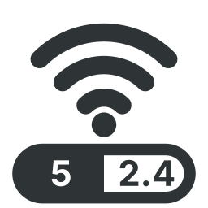
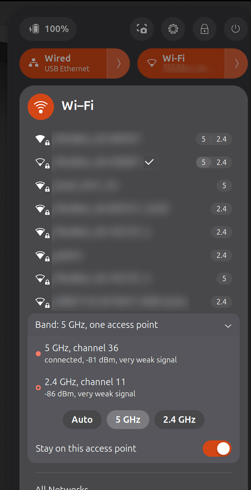

<p align="center"></p>

# Wi-Fi Bands

See which bands each Wi-Fi network is on, and choose the band of the one you
are connected to, right from the Wi-Fi menu of GNOME's Quick Settings.

<p align="center"></p>

## Why

GNOME lists one entry per network and says nothing about the radio behind it.
Most routers broadcast the same name on 2.4 GHz and on 5 GHz, and many of them
do two things that are invisible from the laptop:

- **Band steering.** The router pushes the laptop to 2.4 GHz when the 5 GHz
  signal is weak, then back to 5 GHz a few seconds later, and again. Each move
  drops the connection for a moment and the laptop loses its address. From the
  chair it looks like the Wi-Fi "freezes for a few seconds every few minutes".
- **Radar channels.** 5 GHz channels 52 to 64 and 100 to 144 must give way to
  weather and military radars. A router set to "automatic" often lands on one,
  and when a radar is detected it changes channel and everybody drops at once.

Nothing in the desktop tells you that, and the only way to act on it was the
terminal (`nmcli con modify … 802-11-wireless.band a`). This extension puts what
is going on, and the choice, where you already look for Wi-Fi.

On the machine this was made for, pinning the 5 GHz band and one access point
took the moves between radios from one every two to twenty-five minutes to none
in the following hours, and the latency to the router became about four times
steadier.

## What you get

- **A pill on every network**: `5 | 2.4` when it is on both bands, `5` or `2.4`
  when it is on one. The band in use is the lighter segment. Neutral colours,
  like the rest of Quick Settings, and the check mark stays next to the name.
- **A Band entry** under the list, for the network you are connected to. Open it
  to see each access point (band, channel, signal) with a dot for how healthy it
  looks, and the reason:
  - green: good;
  - yellow: weak signal, crowded channel, radar-sensitive channel, or the laptop
    keeps being moved between access points;
  - red: very weak signal, or that access point refused you before.
- **Auto, 5 GHz or 2.4 GHz**, and a switch to **stay on one access point**.
  Only the profile of the network you are on is changed.
- **A safety net.** If the router does not let you connect within 25 seconds of a
  change, the previous setting comes back by itself and that access point is
  marked as having refused you. A change that was still being checked when the
  extension was turned off (a locked screen, say) is checked at the next start.

## Advantages

- Choosing a band takes two clicks and no terminal.
- You see at a glance which networks have a 5 GHz radio, before connecting.
- A bad choice cannot leave you without Wi-Fi: it is taken back.
- Nothing to install besides the extension, no root, no helper program. It runs
  no command: it talks to NetworkManager through its own library (libnm).
- Nothing is added to the top bar, and nothing is sent anywhere.
- Works with any router, since it only changes your own connection profile.

## How the colours are decided

They are not negotiated with the router: the extension computes them from what
NetworkManager reports. Its signal scale (0 to 100) is the signal in dBm plus
120. Good is -67 dBm or better, poor is below -80 dBm. A channel with two or
more other networks at a usable strength is "crowded". A filled dot is measured
on the access point in use or one that was tried; an empty dot is only an
estimate from the scan.

## Limits

- It cannot turn off the router's own band steering, which other devices still
  go through. If your router lets you, that is the cleaner fix; on a locked
  provider box you may have to ask the provider.
- Health is an estimate from signal strength and the scan. Real quality (retries,
  latency) is not visible to a Shell extension.
- Only 2.4 and 5 GHz profiles are handled, not 6 GHz.
- A band is only offered when the network is seen on it from where you are.
- With several Wi-Fi cards the pills are not shown, and the Band entry follows
  the card in use.

## Install

```
gnome-extensions install --force wifi-bands@griffit.gmail.com.shell-extension.zip
gnome-extensions enable wifi-bands@griffit.gmail.com
```

Log out and in again if the extension does not show up right away (Wayland).
Build the zip with `./pack.sh`. Works on GNOME Shell 45 to 51.

## Tests

```
tests/run.sh                          # the rules, no Shell needed
tools/headless/run.sh                 # a real GNOME Shell, headless, read only
ACTIONS=1 tools/headless/run.sh       # also changes the band, once refused
```

The headless run uses the real NetworkManager: with `ACTIONS=1` the Wi-Fi
reconnects a few times, and the profile is put back at the end.

## Roadmap and issues

Bugs, ideas, planned work and things still to test are tracked in the
[GitHub issues](https://github.com/d101c/wifi-bands/issues); what is planned for
the next version is grouped in a milestone.

- **Report a bug:** open an issue with your distribution, GNOME Shell version,
  what you did, what you expected and what happened, plus any error shown by
  `journalctl -b /usr/bin/gnome-shell`.
- **Suggest an idea:** open an issue that describes what you want to do.

## Licence

GPL-2.0-or-later.
